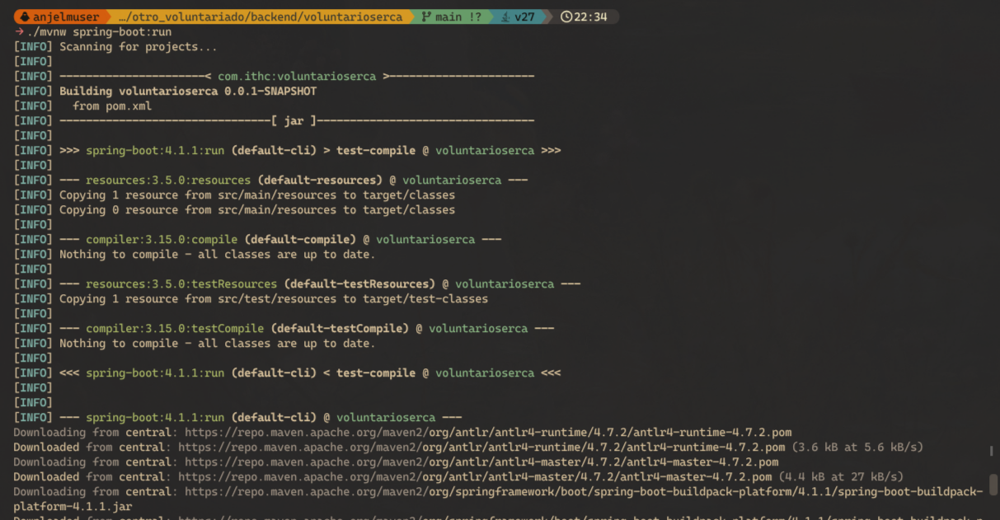
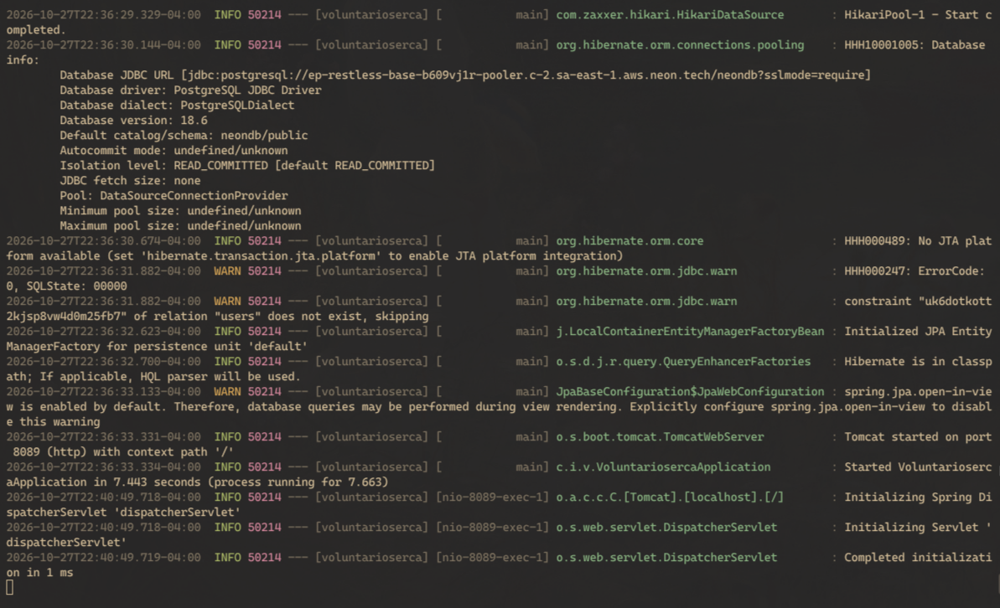
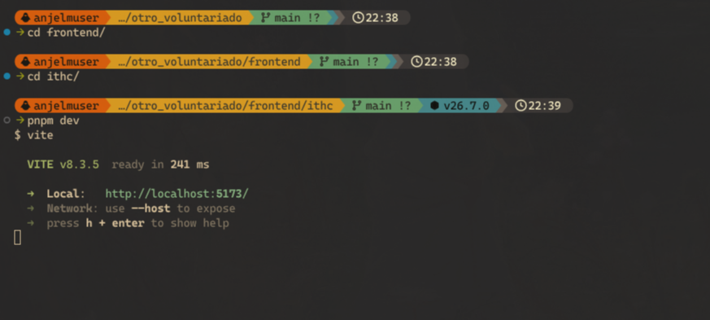
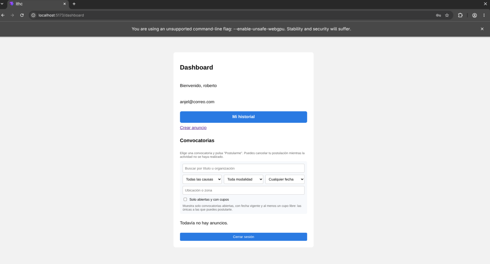
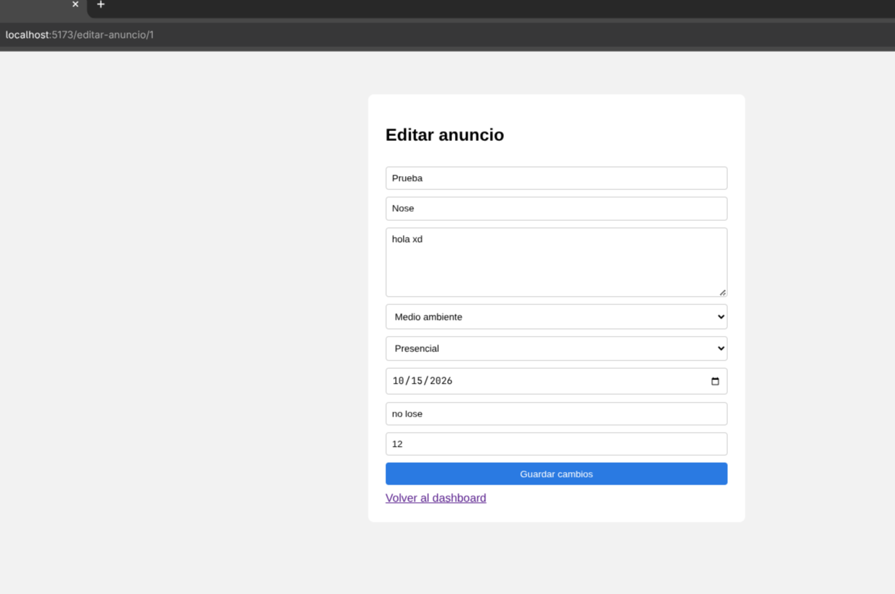
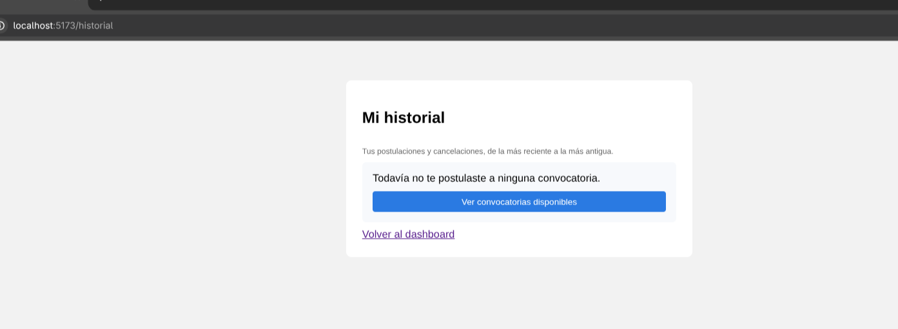
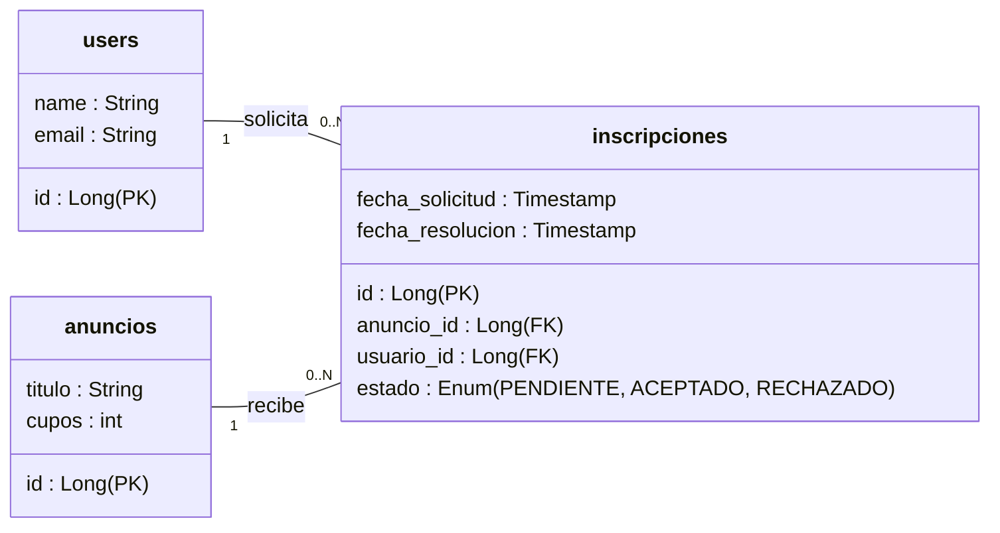

# Clase 17 · Recepción, Ejecución, Recorrido e Impacto

## 1. Proyecto recibido y repositorio

En esta etapa se realizó el traspaso (*switch*) de proyecto de la materia. Se recibió el repositorio correspondiente al sistema **Voluntariado Cerca** (ITHC), creado originalmente para la publicación y gestión de convocatorias de voluntariado.

- **Repositorio:** Proyecto clonado a partir del fork asignado.
- **Estado inicial:** Se revisó la estructura general del proyecto compuesta por:
  - `backend/voluntarioserca`: Aplicación en Java 21 con Spring Boot 4.1.1.
  - `frontend/ithc`: Aplicación cliente en React 19, TypeScript y Vite 8.
  - `docs/`: Documentación previa de decisiones de diseño y heurísticas (clases 15 y 16).

---

## 2. Ejecución del proyecto

Para levantar el entorno completo se ejecutaron los siguientes comandos:

### Backend (Spring Boot + Neon.tech)
Se configuró el acceso a base de datos en la nube con **Neon.tech** (PostgreSQL) con SSL y se inició el servidor:

```bash
cd backend/voluntarioserca
./mvnw spring-boot:run
```

El servidor compiló y levantó correctamente en el puerto `8089`, ejecutando las migraciones automáticas de Hibernate en Neon.





### Frontend (React + Vite + pnpm)
Se migraron las dependencias a **pnpm** para optimizar la instalación y se inició el servidor de desarrollo:

```bash
cd frontend/ithc
pnpm install
pnpm dev
```

El cliente web quedó operativo en `http://localhost:5173`.



---

## 3. Recorrido del sistema

Análisis del flujo actual identificando pantalla, acción realizada, reglas de negocio aplicadas y datos gestionados con referencia a los archivos del código fuente:

| Recorrido | Pantalla | Acción | Regla de negocio | Datos involucrados |
|---|---|---|---|---|
| **1** | Dashboard | Explorar convocatorias y filtrar por causa, modalidad o fecha | Solo postularse si está abierta, con cupos y no vencida. El creador no puede postularse a su propio anuncio. | `GET /api/anuncios` · Entidad `Anuncio` |
| **2** | Editar anuncio | Modificar datos de una convocatoria publicada | Solo el creador puede editar. Los cupos no pueden ser menores a los voluntarios ya inscritos. | `PUT /api/anuncios/{id}` · `AnuncioRequest` |
| **3** | Mi historial | Consultar trazabilidad de postulaciones y cancelaciones | Solo se muestran eventos del usuario autenticado; el estado se calcula dinámicamente. | `GET /api/historial` · `EventoPostulacion` |

---

### Recorrido 1: Dashboard y Convocatorias

- **Pantalla:** `Dashboard.tsx` ([frontend/ithc/src/pages/dashboard/Dashboard.tsx](../frontend/ithc/src/pages/dashboard/Dashboard.tsx)) junto con `AnuncioCard.tsx` y `FiltrosConvocatorias.tsx`.
- **Acción:** El usuario visualiza su sesión, accede a su historial, consulta la lista de convocatorias y aplica filtros combinados (búsqueda por texto, causa, modalidad, fecha o solo disponibles).
- **Regla:** 
  - La postulación se bloquea si la convocatoria está cerrada, vencida por fecha o sin cupos libres ([convocatoria.ts](../frontend/ithc/src/domain/convocatoria.ts#L88), [AnuncioService.java](../backend/voluntarioserca/src/main/java/com/ithc/voluntarioserca/anuncios/AnuncioService.java#L82)).
  - El creador de la convocatoria no puede postularse a la suya ([AnuncioService.java](../backend/voluntarioserca/src/main/java/com/ithc/voluntarioserca/anuncios/AnuncioService.java#L85)).
- **Datos:** Consulta `GET /api/anuncios` que retorna la lista filtrada de `AnuncioResponse` desde la base de datos PostgreSQL.



---

### Recorrido 2: Editar Convocatoria

- **Pantalla:** `EditarAnuncioPage.tsx` ([frontend/ithc/src/anuncios/pages/EditarAnuncioPage.tsx](../frontend/ithc/src/anuncios/pages/EditarAnuncioPage.tsx)) y `AnuncioForm.tsx` ([frontend/ithc/src/anuncios/components/AnuncioForm.tsx](../frontend/ithc/src/anuncios/components/AnuncioForm.tsx)).
- **Acción:** El usuario creador modifica los campos de la convocatoria: título, organización, descripción, causa, modalidad, fecha, lugar y cupos.
- **Regla:**
  - Control de acceso: solo quien creó el anuncio puede editarlo (`esCreador` en frontend y backend) ([AnuncioService.java](../backend/voluntarioserca/src/main/java/com/ithc/voluntarioserca/anuncios/AnuncioService.java#L43)).
  - Integridad de cupos: el número de cupos asignados no puede ser inferior a la cantidad de personas ya postuladas ([AnuncioService.java](../backend/voluntarioserca/src/main/java/com/ithc/voluntarioserca/anuncios/AnuncioService.java#L46)).
- **Datos:** Envío vía `PUT /api/anuncios/{id}` con el payload `AnuncioRequest` para actualizar la entidad `Anuncio`.



---

### Recorrido 3: Mi Historial de Postulaciones

- **Pantalla:** `HistorialPage.tsx` ([frontend/ithc/src/pages/historial/HistorialPage.tsx](../frontend/ithc/src/pages/historial/HistorialPage.tsx)).
- **Acción:** El voluntario consulta el registro cronológico de todas las postulaciones y cancelaciones realizadas, filtradas en tres pestañas: *Todas*, *Activas* y *Canceladas*. En caso de estar vacío, provee un botón directo a convocatorias disponibles.
- **Regla:**
  - Privacidad estricta: cada usuario solo accede a su propio historial extraído del token Bearer de sesión ([HistorialController.java](../backend/voluntarioserca/src/main/java/com/ithc/voluntarioserca/historial/HistorialController.java#L30)).
  - Estado reactivo: el estado de cada postulación (`activa`, `cancelada`, `cerrada`, `realizada`, `eliminada`) se computa en tiempo real según la fecha y estado actual de la convocatoria ([HistorialService.java](../backend/voluntarioserca/src/main/java/com/ithc/voluntarioserca/historial/HistorialService.java#L36)).
- **Datos:** Consulta `GET /api/historial` obteniendo eventos desde la tabla `historial_postulaciones` (`EventoPostulacion`).



---

## 4. Análisis de Impacto: Tarea 5 (Aprobación y Rechazo de Postulaciones)

### Objetivo de la Tarea 5
Actualmente, el sistema opera con inscripción directa: en cuanto un voluntario presiona "Postularme", queda inmediatamente registrado como voluntario y se descuenta un cupo.  
La **Tarea 5** modifica este paradigma introduciendo un flujo de **solicitud y aprobación**: la postulación queda en espera y la organización (creador de la convocatoria) debe tener el control de **aceptar o rechazar** a cada postulante.

---

### 1. Transformación del Modelo de Datos (Tabla Intermedia `inscripciones`)

Actualmente, la relación entre `User` y `Anuncio` se gestiona mediante un `@ManyToMany` simple sin atributos adicionales:

```java
// Modelo actual en Anuncio.java (tabla inscripciones sin estado):
@ManyToMany
@JoinTable(name = "inscripciones")
private Set<User> voluntarios = new HashSet<>();
```

Para la Tarea 5, la tabla intermedia `inscripciones` debe elevarse a una **entidad intermedia formal** (`Inscripcion`) que conecte al usuario con la convocatoria, incorporando atributos de control:



#### Atributos de la tabla intermedia `inscripciones`:
- `id`: Identificador único (o clave compuesta `anuncio_id` + `usuario_id`).
- `anuncio_id`: FK hacia la convocatoria.
- `usuario_id`: FK hacia el voluntario solicitante.
- `estado`: Enum con tres valores:
  - **`PENDIENTE`** (valor por defecto al postularse).
  - **`ACEPTADO`** (cuando el organizador aprueba la solicitud).
  - **`RECHAZADO`** (cuando el organizador no admite la solicitud).
- `fecha_solicitud`: Fecha y hora de envío de la solicitud.
- `fecha_resolucion`: Fecha y hora en que el organizador tomó la decisión.

---

### 2. Análisis del Estado `RECHAZADO`: Alternativas de Diseño e Interacción

Cuando el organizador decide rechazar una solicitud, se abren dos alternativas arquitectónicas y de experiencia de usuario:

| Alternativa | Mecánica | Ventajas | Desventajas | Decisión recomendada |
|---|---|---|---|---|
| **Opción A: Persistir como `RECHAZADO`** | El registro se conserva en la tabla intermedia con `estado = RECHAZADO`. | **Trazabilidad total:** la organización recuerda a quién descartó; **previene spam:** el voluntario no puede saturar al organizador reenviando solicitudes una y otra vez. | El voluntario queda bloqueado para esa convocatoria específica. | **Recomendada:** Cumple con la heurística H1 (el usuario ve su estado "No admitido") y previene insistencias no deseadas. |
| **Opción B: Eliminar el registro** | La postulación se borra físicamente de `inscripciones`. | Deja la tabla con menos registros y permite al usuario volver a postularse si corrigió algún dato o si el rechazo fue accidental. | El organizador pierde el historial de descartados y un voluntario no deseado puede insistir indefinidamente. | No recomendada para la tabla de postulaciones activas, aunque se puede respaldar en el historial. |

> **Criterio de diseño:** Mantener el registro con estado `RECHAZADO`. En la interfaz, cuando el voluntario vea que fue rechazado, se le ofrece una salida constructiva (Heurística H9: recuperación de errores): el botón *"Ver convocatorias disponibles"* para invitarlo a buscar otras actividades donde sí pueda participar.

---

### 3. Regla Estricta para el Cálculo de Cupos (Solo cuentan los Aceptados)

Esta es la regla central de negocio que cambia en la Tarea 5:

> **Regla de oro de los cupos:**  
> **Únicamente los voluntarios con estado `ACEPTADO` consumen cupo.**  
> Las solicitudes en estado `PENDIENTE` y `RECHAZADO` **no descuentan cupos**.

#### Ejemplo práctico:
Si una convocatoria tiene **10 cupos en total** y en la tabla intermedia existen **10 registros** distribuidos así:
- 6 solicitudes en estado `PENDIENTE`
- 2 solicitudes en estado `RECHAZADO`
- 2 solicitudes en estado `ACEPTADO`

La convocatoria **NO está llena**. Únicamente hay **2 cupos ocupados de 10**. Quedan **8 cupos libres** para seguir recibiendo solicitudes o para que el organizador acepte a 8 voluntarios más.

#### Impacto en el código:

1. **En Backend ([AnuncioService.java](../backend/voluntarioserca/src/main/java/com/ithc/voluntarioserca/anuncios/AnuncioService.java)):**
   - El cálculo de cupos libres pasa de `anuncio.getVoluntarios().size()` a una consulta filtrada:
     ```java
     long aceptados = inscripcionRepository.countByAnuncioIdAndEstado(anuncioId, EstadoInscripcion.ACEPTADO);
     boolean hayCupos = aceptados < anuncio.getCupos();
     ```
   - **Al aceptar:** Se valida estrictamente que `aceptados < anuncio.getCupos()`. Si ya se llegó al tope, el backend arroja error 409 (*"No quedan cupos disponibles para aceptar más voluntarios"*).
   - **Al solicitar postulación:** Se permite enviar solicitud mientras la convocatoria esté abierta y con fecha vigente (incluso si hay muchos pendientes), o hasta que los aceptados completen el cupo.
   - **Al editar el anuncio:** La validación de cupos mínimos cambia a:
     `if (req.cupos() < totalAceptados) throw new AnuncioException(400, "Los cupos no pueden ser menos que los voluntarios ya aceptados");`

2. **En Filtros de Búsqueda ([AnuncioFiltro.java](../backend/voluntarioserca/src/main/java/com/ithc/voluntarioserca/anuncios/AnuncioFiltro.java)):**
   - El filtro `"Solo abiertas y con cupos"` (`disponibles=true`) debe comparar el total de cupos contra el conteo de inscripciones con `estado = 'ACEPTADO'`.

3. **En Frontend ([convocatoria.ts](../frontend/ithc/src/domain/convocatoria.ts) y [AnuncioCard.tsx](../frontend/ithc/src/anuncios/components/AnuncioCard.tsx)):**
   - `cuposLibres(anuncio)` y `textoCupos(anuncio)` se calcularán exclusivamente restando los aceptados:
     *"Quedan 8 de 10 cupos"* (aunque existan 6 solicitudes pendientes en revisión).

---

### 4. Nuevos Endpoints y Lógica de Servicios

#### En [AnuncioController.java](../backend/voluntarioserca/src/main/java/com/ithc/voluntarioserca/anuncios/AnuncioController.java):
| Método | Endpoint | Rol permitido | Acción |
|---|---|---|---|
| `POST` | `/api/anuncios/{id}/inscribirse` | Voluntario | Crea la solicitud en estado `PENDIENTE`. |
| `DELETE` | `/api/anuncios/{id}/inscribirse` | Voluntario | Cancela la solicitud mientras esté en `PENDIENTE`. |
| `POST` | `/api/anuncios/{id}/solicitudes/{usuarioId}/aceptar` | Creador | Valida cupos libres y cambia estado a `ACEPTADO`. |
| `POST` | `/api/anuncios/{id}/solicitudes/{usuarioId}/rechazar` | Creador | Cambia el estado a `RECHAZADO`. |

#### DTO para la vista del Creador:
El record `Postulado` enviado al creador debe enriquecerse para mostrar el estado de cada persona:
```java
record PostuladoResponse(Long usuarioId, String nombre, String email, String estado, String fechaSolicitud) {}
```

---

### 5. Impacto en la Interfaz de Usuario (Frontend)

1. **Vista de la tarjeta para el Organizador ([AnuncioCard.tsx](../frontend/ithc/src/anuncios/components/AnuncioCard.tsx)):**
   - En la sección *"Postulados"*, se muestran pestañas o etiquetas para distinguir:
     - **Pendientes:** Muestra el nombre y dos botones: `[✓ Aceptar]` (color verde) y `[✕ Rechazar]` (color secundario/peligro).
     - **Aceptados:** Lista a los voluntarios confirmados con un badge verde *"Aceptado"*.
     - **Rechazados:** Lista con badge gris *"Rechazado"*.
   - El botón `[✓ Aceptar]` se desactiva automáticamente si ya se llenaron los cupos totales.

2. **Vista de la tarjeta para el Voluntario ([AnuncioCard.tsx](../frontend/ithc/src/anuncios/components/AnuncioCard.tsx)):**
   - Reemplazar el mensaje único `"✓ Estás postulado"` por feedback contextual según su estado:
     - **Si está Pendiente:** Badge amarillo `"⏳ Solicitud enviada (pendiente de aprobación)"` con botón `"Cancelar solicitud"`.
     - **Si está Aceptado:** Badge verde `"✓ ¡Fuiste aceptado en esta convocatoria!"`.
     - **Si está Rechazado:** Mensaje `"Tu solicitud no fue admitida en esta ocasión"` con botón `"Ver convocatorias disponibles"`.

3. **Historial del Voluntario ([HistorialPage.tsx](../frontend/ithc/src/pages/historial/HistorialPage.tsx)):**
   - Se actualizan los estados legibles:
     - *Solicitud enviada (Pendiente)*
     - *Postulación aprobada*
     - *Postulación rechazada*
     - *Cancelada por el usuario*

---

### 6. Principios de Interacción (HCI / ITHC)
- **H1 (Visibilidad del estado del sistema):** El voluntario siempre tiene certeza visual de en qué etapa está su solicitud mediante badges y mensajes contextuales (evita la incertidumbre de no saber si ya fue admitido o sigue en revisión).
- **H3 (Control y libertad del usuario):** El voluntario puede cancelar su solicitud libremente mientras se encuentre en estado `PENDIENTE`.
- **H5 (Prevención de errores):** Modal de confirmación antes de rechazar a un voluntario y deshabilitación visual del botón `[Aceptar]` si ya se alcanzó el tope de cupos aceptados.
- **H9 (Ayuda a recuperarse de errores):** Si el voluntario resulta rechazado, la interfaz le ofrece de inmediato la alternativa constructiva con el botón *"Ver convocatorias disponibles"*.
