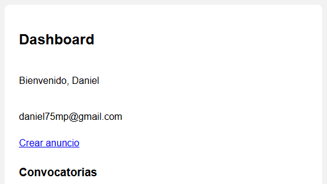
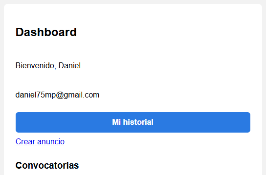
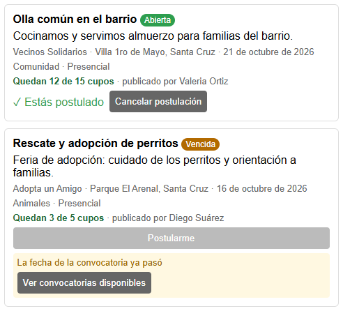
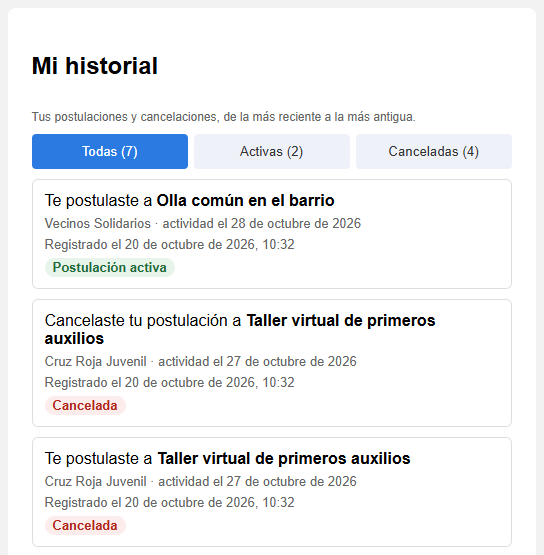
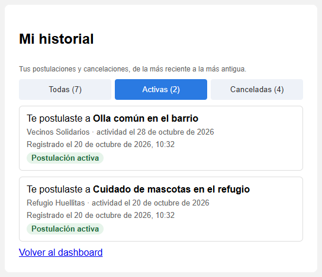
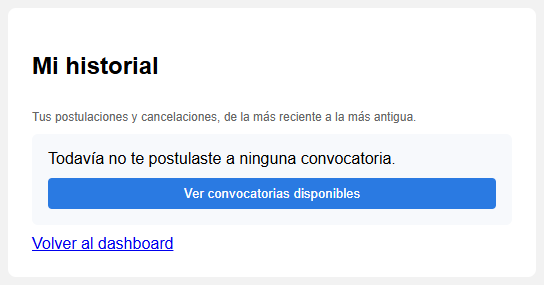

# Decisiones de interacción (clase 16)

Funcionalidad: encontrar una convocatoria y postularse.

Revisamos la lista de convocatorias, los filtros y la tarjeta de cada convocatoria con tres principios: Fitts (alcanzar), Hick (elegir) y carga cognitiva (comprender).

| Hallazgo | Captura | Justificación | Estado |
|---|---|---|---|
| Fitts | Quitar un filtro activo | El botón ✕ mide 23 x 18 px y solo esa parte se puede tocar | Documentado |
| Hick | Panel de filtros | Seis controles aparecen a la vez antes de ver una sola convocatoria | Documentado |
| Carga cognitiva | Cupos en la tarjeta | Hay que restar "4/5" para saber cuántos cupos quedan | Corregido |

## Fitts

Pantalla: Dashboard, etiquetas de filtros activos ("Causa: Salud ✕").  
Qué observamos: para quitar un filtro hay que tocar la ✕. Medimos el botón en la app y mide 23 x 18 px. El resto de la etiqueta no hace nada al tocarla.  
Justificación: el objetivo es pequeño y el área activa es solo el ícono, así que exige apuntar con precisión, sobre todo en el celular.  
Código: [FiltrosConvocatorias.tsx](../frontend/ithc/src/anuncios/components/FiltrosConvocatorias.tsx#L76), [index.css](../frontend/ithc/src/index.css)  
Captura:

## Hick

Pantalla: Dashboard, panel de filtros.  
Qué observamos: antes de ver la lista aparecen búsqueda, causa, modalidad, fecha, ubicación y "Solo abiertas y con cupos". Son seis decisiones con la misma importancia.  
Justificación: todas compiten al mismo tiempo. Lo más usado (buscar y ver solo las disponibles) podría quedar visible y el resto ir en "Más filtros".  
Código: [FiltrosConvocatorias.tsx](../frontend/ithc/src/anuncios/components/FiltrosConvocatorias.tsx#L11)  
Captura:

## Carga cognitiva

Pantalla: tarjeta de una convocatoria, por ejemplo "Apoyo en vacunación comunitaria".  
Qué observamos: la tarjeta dice "4/5 postulados". Para decidir si postularse hay que restar y darse cuenta de que queda un solo cupo. No se distingue una convocatoria con un cupo de una con muchos.  
Justificación: la persona tiene que interpretar y calcular un dato que la app ya conoce. Lo que necesita en ese momento es cuántos cupos quedan.  
Código: [AnuncioCard.tsx](../frontend/ithc/src/anuncios/components/AnuncioCard.tsx#L66)  
Captura:

## Hallazgo elegido

Elegimos carga cognitiva porque aparece en todas las tarjetas, justo cuando la persona decide si se postula. Fitts y Hick quedan documentados para corregir después.

## Corrección

Antes la tarjeta decía "4/5 postulados". Ahora dice directamente cuántos cupos quedan: "Quedan 3 de 5 cupos", "Último cupo" cuando queda uno y "Sin cupos" cuando se llenó. Cuando queda uno o ninguno el texto cambia de color, pero el significado está en las palabras y no depende del color.  
Código: [convocatoria.ts](../frontend/ithc/src/domain/convocatoria.ts#L80) (textoCupos), [AnuncioCard.tsx](../frontend/ithc/src/anuncios/components/AnuncioCard.tsx#L68)  
Pruebas: convocatoria.test.ts (cupos que quedan) y AnuncioCard.test.tsx (la tarjeta muestra los cupos que quedan en lugar de 4/5).  
Comprobación: volvimos a abrir la lista con Daniel y en "Apoyo en vacunación comunitaria" ya se lee "Último cupo" sin tener que calcular.

Antes:

Después:

# Historial de postulaciones (tarea 4)

Pregunta que responde: ¿qué postulaciones realicé y en qué estado están?  
Issue principal: #17

Cada postulación y cada cancelación se guarda en la tabla historial_postulaciones con el usuario, la convocatoria, el tipo y la fecha. Antes una cancelación borraba la fila de inscripciones y no quedaba rastro.  
Se guarda en: [AnuncioService.java](../backend/voluntarioserca/src/main/java/com/ithc/voluntarioserca/anuncios/AnuncioService.java#L100) (postulación) y [AnuncioService.java](../backend/voluntarioserca/src/main/java/com/ithc/voluntarioserca/anuncios/AnuncioService.java#L114) (cancelación)  
Se consulta en: [HistorialController.java](../backend/voluntarioserca/src/main/java/com/ithc/voluntarioserca/historial/HistorialController.java#L30) y [HistorialService.java](../backend/voluntarioserca/src/main/java/com/ithc/voluntarioserca/historial/HistorialService.java#L26). El usuario sale del token, así que cada uno ve solo lo suyo, del más reciente al más antiguo.

| Decisión | Antes | Después |
|---|---|---|
| Fitts | No había forma de llegar al historial | Botón "Mi historial" de 480 x 42 px arriba del dashboard |
| Hick | Postulaciones mezcladas con todas las convocatorias | Solo tres pestañas: Todas, Activas y Canceladas |
| Carga cognitiva | Había que buscar "Estás postulado" tarjeta por tarjeta | Cada evento dice qué pasó, cuándo y en qué estado está |

## Fitts

Antes: para ver mis postulaciones tenía que bajar por las 17 convocatorias del dashboard (más de 4600 px de página). No había ninguna entrada al historial.  
Después: el botón "Mi historial" está arriba, ocupa todo el ancho de la tarjeta y mide 480 x 42 px, cerca de donde empieza la pantalla.  
Código: [Dashboard.tsx](../frontend/ithc/src/pages/dashboard/Dashboard.tsx#L19), [index.css](../frontend/ithc/src/index.css)

Antes:

Después:

## Hick

Antes: las postulaciones estaban mezcladas con convocatorias propias, cerradas, vencidas y de otros. Para separar lo mío había que comparar cada tarjeta.  
Después: el historial solo tiene tres pestañas (Todas, Activas y Canceladas) y cada una muestra cuántos eventos tiene. No agregamos más filtros para que no compitan entre sí.  
Código: [historial.ts](../frontend/ithc/src/domain/historial.ts#L32) (PESTANAS), [HistorialPage.tsx](../frontend/ithc/src/pages/historial/HistorialPage.tsx#L57)

Antes:

Después:

## Carga cognitiva

Antes: para saber en qué me postulé tenía que recordar los nombres o buscar "✓ Estás postulado". Si cancelaba, no quedaba nada que lo recordara.  
Después: cada evento muestra primero qué pasó ("Te postulaste a" o "Cancelaste tu postulación a"), la convocatoria, la fecha de la actividad, cuándo se registró y el estado actual en palabras (Postulación activa, Cancelada, Convocatoria cerrada, Actividad realizada). No hay que abrir otra pantalla.  
Código: [historial.ts](../frontend/ithc/src/domain/historial.ts#L18) (TIPOS y ESTADOS_POSTULACION), [HistorialService.java](../backend/voluntarioserca/src/main/java/com/ithc/voluntarioserca/historial/HistorialService.java#L36) (estado), [HistorialPage.tsx](../frontend/ithc/src/pages/historial/HistorialPage.tsx#L75)

Antes:

Después:

## Estado vacío

Si la persona todavía no se postuló a nada, el historial lo dice y ofrece "Ver convocatorias disponibles", que lleva al dashboard con el filtro de disponibles activado.  
Código: [HistorialPage.tsx](../frontend/ithc/src/pages/historial/HistorialPage.tsx#L48)

## Pruebas

Backend: AnuncioServiceTest (postularse y cancelar guardan un evento, una postulación rechazada no guarda nada), HistorialServiceTest (estado de cada postulación) y EventoPostulacionRepositoryTest (cada usuario ve solo lo suyo y en orden).  
Frontend: historial.test.ts (fecha y pestañas) y HistorialPage.test.tsx (estado vacío y texto de cada evento).
