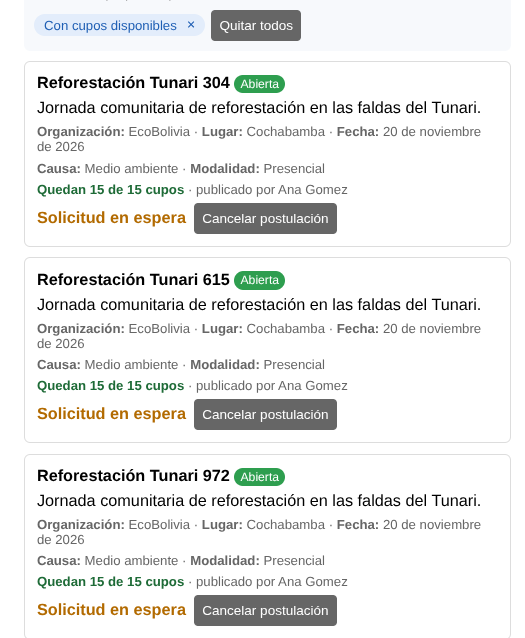
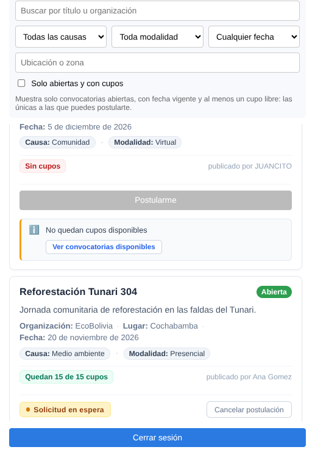

# Clase 20 - Accesibilidad y Distribución de Información en Dashboard

## 1. Integrantes

- **Estudiante:** `Roberto Anjel Santos Castro`

---

## 2. Problema que Queremos Solucionar

En la versión inicial del Dashboard de *Voluntariado Cerca*, todas las convocatorias se desplegaban en un **listado plano vertical continuo**, ordenadas únicamente por identificador numérico descendente.

Esta presentación ocasionaba deficiencias sustanciales de **accesibilidad cognitiva, ergonomía y usabilidad**:

1. **Sobrecarga cognitiva:** Un voluntario que ingresaba a la plataforma para buscar actividades inmediatas debía inspeccionar una a una todas las tarjetas para distinguir qué convocatorias correspondían al día de hoy, cuáles eran para los próximos días y cuáles estaban planificadas para fechas lejanas o ya habían concluido.
2. **Ausencia de jerarquía temporal:** No existían puntos de referencia ni divisiones visuales que organizaran el volumen de información por urgencia o relevancia cronológica.
3. **Desplazamiento global desbordado (Scroll general de la página):** Al existir múltiples convocatorias publicadas, toda la página Web crecía verticalmente de forma indefinida. Cuando el usuario se desplazaba hacia abajo para leer los anuncios, la cabecera del Dashboard, las pestañas de navegación (*Explorar* / *Mis anuncios*) y los paneles de búsqueda y filtros desaparecían de la pantalla, obligando a realizar continuos desplazamientos de subida y bajada.
4. **Diseño austero sin delimitación interna en las tarjetas:** El contenido de cada anuncio carecía de una separación visual clara entre su título, estado, metadatos (organización, lugar, fecha), etiquetas de causa/modalidad y el contador de cupos disponibles.
5. **Desorden y falta de jerarquía en botones de estado y avisos:** Cuando un voluntario tenía una postulación pendiente, el texto "Solicitud en espera" y el botón "Cancelar postulación" aparecían amontonados en la misma línea sin separación clara. Igualmente, los avisos de "No quedan cupos disponibles" y el indicador de cupos carecían de un diseño estructurado y limpio que orientara visualmente al usuario.

---

## 3. Dibujo de la Propuesta (Esquema de Distribución)

### Antes: Listado plano indiferenciado y scroll global de la página
```text
┌────────────────────────────────────────────────────────┐ ▲
│ [Dashboard] Voluntariado Cerca                         │ █ (Scroll de toda
│ Pestañas: [ Explorar ] [ Mis anuncios ]                │ █  la página web;
│ [Filtros: Causa | Modalidad | Búsqueda...]             │ │  al bajar, se
│                                                        │ │  pierden los
│ ┌────────────────────────────────────────────────────┐ │ │  filtros y el
│ │ Limpieza del río · Abierta                         │ │ │  encabezado)
│ │ Organización: Eco · Lugar: Cochabamba · 25 de nov  │ │ │
│ └────────────────────────────────────────────────────┘ │ │
│ ┌────────────────────────────────────────────────────┐ │ │
│ │ Apoyo en comedor · Abierta                         │ │ │
│ │ Organización: Manos · Lugar: La Paz · 05 de nov    │ │ │
│ │ Solicitud en espera [Cancelar postulación]         │ │ │ (Elementos sin
│ └────────────────────────────────────────────────────┘ │ │  separación)
│ ┌────────────────────────────────────────────────────┐ │ │
│ │ Vacunación animal · Abierta                        │ │ │
│ │ Organización: Patitas · Lugar: Santa Cruz · 08 nov │ │ │
│ │ [Postularme (disabled)]                            │ │ │
│ │ No quedan cupos disponibles                        │ │ │
│ │ [Ver convocatorias disponibles]                    │ │ │
│ └────────────────────────────────────────────────────┘ │ │
│ (Todas las fechas y estados mezclados en un solo bloque)│ ▼
└────────────────────────────────────────────────────────┘
```

### Después: Secciones temporales semánticas, cards estructuradas y contenedor con scroll independiente
```text
┌────────────────────────────────────────────────────────┐
│ [Dashboard] Voluntariado Cerca                         │ (Encabezado y
│ Pestañas: [ Explorar ] [ Mis anuncios ]                │  filtros fijos
│ [Filtros: Causa | Modalidad | Búsqueda...]             │  siempre visibles)
│ Convocatorias · Hoy es 5 de noviembre de 2026          │
│                                                        │
│ ┌── [ Contenedor Scrollable: max-height: 480px ] ────┐ │
│ │ ── HOY · 1 ─────────────────────────────────────── │▲│ (Barra de scroll
│ │ ┌────────────────────────────────────────────────┐ │█│  propia solo para
│ │ │ Apoyo en comedor                 [ Abierta ]   │ │█│  el listado de
│ │ │ Preparación y entrega de almuerzos comunitarios│ │││  convocatorias)
│ │ │ Organización: Manos · Lugar: La Paz · 05 de nov│ │││
│ │ │ [Causa: Salud]  [Modalidad: Presencial]        │ │││
│ │ │ ────────────────────────────────────────────── │ │││
│ │ │ [Quedan 3 de 10 cupos]    publicado por Carlos │ │││
│ │ │ ────────────────────────────────────────────── │ │││
│ │ │ [● Solicitud en espera] [Cancelar postulación] │ │││ (Separados con
│ │ └────────────────────────────────────────────────┘ │││  distribución limpia)
│ │                                                    │ ││
│ │ ── ESTA SEMANA · 1 ─────────────────────────────── │ ││
│ │ ┌────────────────────────────────────────────────┐ │ ││
│ │ │ Vacunación animal                [ Abierta ]   │ │ ││
│ │ │ Organización: Patitas · Lugar: SC · 08 de nov  │ │ ││
│ │ │ [Causa: Animales]  [Modalidad: Presencial]     │ │ ││
│ │ │ ────────────────────────────────────────────── │ │││
│ │ │ [Sin cupos]                publicado por Lucía │ │││
│ │ │ ────────────────────────────────────────────── │ │││
│ │ │ [Postularme (deshabilitado)]                   │ │││
│ │ │ ┌─ Aviso Informativo ────────────────────────┐ │ │││
│ │ │ │ ℹ No quedan cupos disponibles              │ │ │││
│ │ │ │   [Ver convocatorias disponibles]          │ │ │││
│ │ │ └────────────────────────────────────────────┘ │ │││
│ │ └────────────────────────────────────────────────┘ │ ││
│ │                                                    │ ││
│ │ ── PRÓXIMAS CONVOCATORIAS · 1 ──────────────────── │ ││
│ │ ┌────────────────────────────────────────────────┐ │ ││
│ │ │ Limpieza del río                 [ Abierta ]   │ │ ││
│ │ │ Organización: Eco · Lugar: CBBA · 25 de nov    │ │ ││
│ │ │ [Causa: Medio ambiente]  [Presencial]          │ │ ││
│ │ │ ────────────────────────────────────────────── │ │││
│ │ │ [Quedan 8 de 15 cupos]       publicado por Ana │ │▼│
│ │ └────────────────────────────────────────────────┘ │ │
│ └────────────────────────────────────────────────────┘ │
└────────────────────────────────────────────────────────┘
```

---

## 4. Motivo

1. **Principio de *Chunking* (Agrupamiento Cognitivo):**  
   Dividir los anuncios en bloques temporales inmediatos (**Hoy**, **Esta semana**, **Próximas convocatorias** y **Concluidas**) permite que el usuario asimile la información en fragmentos lógicos jerarquizados, reduciendo radicalmente el esfuerzo de procesamiento mental.
2. **Escaneo visual rápido (*Scannability*) con contadores numéricos:**  
   Los indicadores cuantitativos (`· {N}`) en cada cabecera ofrecen un resumen instantáneo del volumen de convocatorias sin requerir lectura exhaustiva ni desplazamiento forzado.
3. **Contenedor Scrollable Independiente y Ergonómico:**  
   Al encapsular únicamente la lista de tarjetas dentro de un contenedor con altura máxima delimitada (`max-height: 480px; overflow-y: auto;`), la cabecera del Dashboard, las pestañas de navegación y los filtros de búsqueda permanecen fijos y siempre visibles en pantalla. Esto elimina el desplazamiento vertical de toda la página y previene la pérdida de contexto.
4. **Accesibilidad Semántica y Navegación por Teclado (`WCAG 2.1`):**  
   - Se emplearon etiquetas semánticas estructuradas (`<section aria-labelledby="...">`, `<h4>`), permitiendo a usuarios con lectores de pantalla navegar y saltar directamente entre secciones temporales.
   - El contenedor scrollable incluye `tabIndex={0}`, `role="region"` y `aria-label="Convocatorias organizadas por fecha"`, garantizando cumplimiento del criterio de accesibilidad por teclado (SC 2.1.1) para scroll con flechas de dirección.
5. **Organización decente y limpia en las Cards (Respetando la Constitución):**  
   Se introdujo una jerarquía visual con CSS plano y tipografía cuidada sin dependencias externas:
   - **Cabecera:** Título en negrita con espaciado adecuado y badge de estado alineado.
   - **Cuerpo:** Descripción con tipografía legible y metadatos separados con etiquetas descriptivas claras (`Organización:`, `Lugar:`, `Fecha:`).
   - **Etiquetas tipo pill:** Causa y modalidad agrupadas en pequeñas píldoras suaves que facilitan el reconocimiento visual.
   - **Pie:** Indicador de cupos con diferenciación cromática semántica y autor de la publicación.
6. **Diseño Limpio en Estados de Solicitud y Bloqueo de Cupos:**  
   - **Solicitud en espera:** Se transformó el texto plano en un badge píldora color ámbar con punto indicador (`● Solicitud en espera`), ubicándolo a la izquierda y separando el botón de acción secundaria (`Cancelar postulación`) a la derecha mediante `justify-content: space-between` y un divisor sutil superior, eliminando la sensación de elementos amontonados.
   - **Bloqueo y agotamiento de cupos:** El componente de aviso ("No quedan cupos disponibles") fue rediseñado con fondo suave, acento ámbar a la izquierda, ícono informativo y el botón "Ver convocatorias disponibles" integrado limpiamente.
   - **Indicadores de cupos semánticos:** Se agregaron estilos diferenciados para cupos libres (`.cupos` verde suave), últimos cupos (`.cupos.pocos` ámbar) y sin cupos (`.cupos.sin-cupos` rojo suave), brindando retroalimentación visual inmediata.

---

## 5. Capturas de Antes y Después

### 5.1. Antes (Listado plano indiferenciado con scroll general)


### 5.2. Después (Dashboard con divisiones temporales, cards mejoradas y scroll independiente)


---

## 6. Resultado de la Prueba

La implementación fue verificada mediante suites de pruebas automatizadas y compilación de producción:

- **Frontend:**
  - Pruebas unitarias de dominio (`convocatoria.test.ts`): Validación del algoritmo de agrupación temporal (`agruparAnunciosPorFecha`) clasificando con precisión en `hoy`, `estaSemana`, `proximas` y `pasadas`.
  - Pruebas unitarias de Dashboard (`Dashboard.test.tsx`): Validación del renderizado condicional de secciones temporales, encabezados y contadores dinámicos.
  - Pruebas de tarjeta (`AnuncioCard.test.tsx`): 15 pruebas aprobadas validando la presencia de etiquetas descriptivas, badges y datos.
  - **Total pruebas Frontend:** **58 pruebas aprobadas (9 suites, 0 fallos)**.
  - **Compilación TypeScript/Vite:** Exitosa sin advertencias (`pnpm build`, 120 módulos transformados).

- **Backend:**
  - **Total pruebas Backend:** **62 pruebas aprobadas** con Maven (`./mvnw test`), garantizando la integridad de filtros, convocatorias e historial.

---

## 7. Enlace del Commit

- **Enlace al commit de la funcionalidad:**  
  https://github.com/anjelradio/voluntariado-cerca-app/commit/1ffe18862f5f55005273075601f5b624646c7abc

