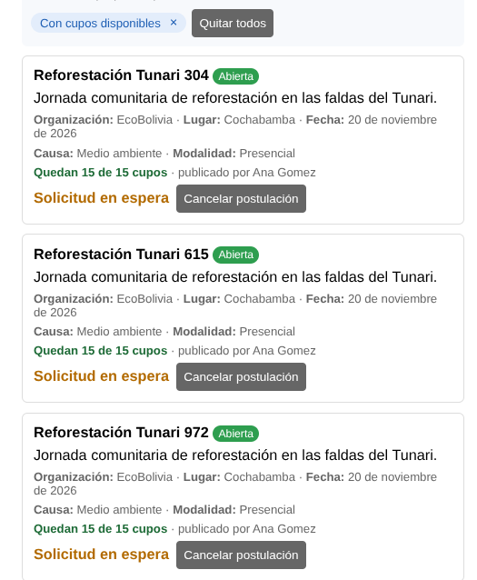
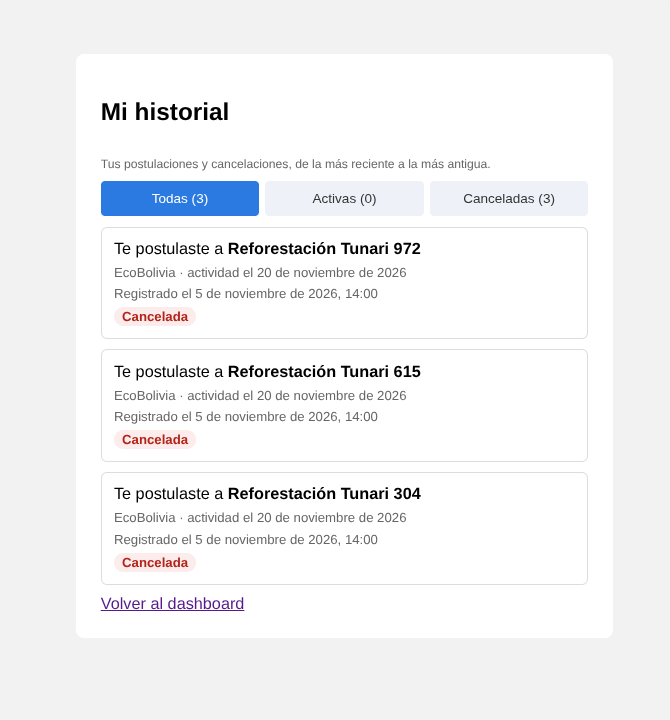
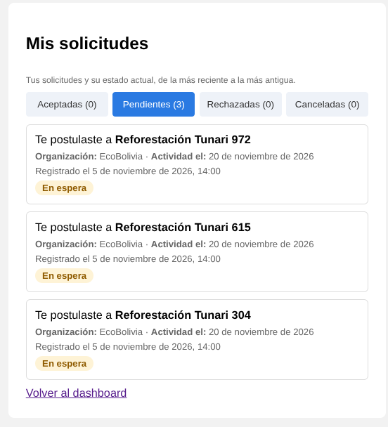

# Tarea 7

## 1. Enlaces y Referencias

- **Enlace al feedback recibido:** 
  https://github.com/ary10220/ihc_segundo_proyecto/commit/327eb90b67231a10381949428565970dbb8fec8f

- **Enlace al Commit (Mejoras por Feedback — Resultados 1 y 2):**  
  https://github.com/anjelradio/voluntariado-cerca-app/commit/9cf5c4b3c8e65cea294995a9bea27b72a041f63e

- **Enlace al Commit (Nueva Funcionalidad de Clase):**  
  https://github.com/anjelradio/voluntariado-cerca-app/commit/63f413971c7c383fb3357bdd1493cb6db79d3447

---

## 2. Datos de la Evaluación Recibida

- **Evaluadora:** Ariany Claure Cota (Grupo: Franco — Presupuesto Estudiantil)
- **Repositorio evaluado:** [voluntariado-cerca-app](https://github.com/anjelmuser/voluntariado-cerca-app)
- **Caso de estudio:** Voluntariado Cerca
- **Objetivo de la sección:** Corregir las fricciones y observaciones del feedback recibido entre pares, manteniendo la simplicidad visual y funcional del proyecto, con trazabilidad completa de cambios y evidencias visuales.

---

## 3. Mejora por Feedback

### 3.1. Resultado 1: Diferenciación Clara entre Causa y Lugar (Opción A)

#### 3.1.1. Problema identificado en el feedback
La evaluadora señaló en su reporte de primera impresión y tabla de fricciones:
> *"Al revisar la información de una convocatoria, no queda claro si el campo causa identifica el motivo o tipo de voluntariado, o si se refiere al lugar donde se realizará."*  
> *"No queda claro si el dato mostrado corresponde a la causa o al lugar."*

En la interfaz original, los datos de la convocatoria se concatenaban únicamente con puntos separadores (`·`) sin prefijos descriptivos. Para un voluntario nuevo, ver valores como `EcoBolivia · Cochabamba · 20 de noviembre de 2026` y `Medio ambiente · Presencial` generaba ambigüedad sobre qué dato era la causa, cuál la organización y cuál la ubicación física.

#### 3.1.2. Solución implementada
Se modificó el componente `AnuncioCard.tsx` para incorporar etiquetas semánticas y directas (`<strong>Organización:</strong>`, `<strong>Lugar:</strong>`, `<strong>Fecha:</strong>`, `<strong>Causa:</strong>` y `<strong>Modalidad:</strong>`), conservando estrictamente el estilo visual austero, limpio y minimalista del proyecto (sin agregar librerías pesadas ni colores distractores).

- **Archivos modificados:**
  - `frontend/ithc/src/anuncios/components/AnuncioCard.tsx`: Inclusión de etiquetas descriptivas en las líneas de detalle.
  - `frontend/ithc/src/anuncios/components/AnuncioCard.test.tsx`: Nueva suite de pruebas unitarias que valida la presencia de cada etiqueta en el DOM.

#### 3.1.3. Comparación Antes y Después

##### Antes (Formato ambiguo)
```text
EcoBolivia · Cochabamba · 20 de noviembre de 2026
Medio ambiente · Presencial
```

##### Después (Formato explícito y simple)
```text
Organización: EcoBolivia · Lugar: Cochabamba · Fecha: 20 de noviembre de 2026
Causa: Medio ambiente · Modalidad: Presencial
```

#### 3.1.4. Evidencias visuales (Captura actual)

##### Actual:


---

### 3.2. Resultado 2: Navegación a "Mis Solicitudes", Gestión de Postulantes Rechazados y Filtro de Estados (Opción B)

#### 3.2.1. Problema identificado en el feedback
La evaluadora señaló en su reporte de usabilidad y tabla de fricciones:
> *"Consultar solicitudes enviadas: No se identifica fácilmente dónde revisar las solicitudes aceptadas ni el tiempo estimado de respuesta."*  
> *"Propuesta: Agregar una sección 'Mis solicitudes' con estados claros —por ejemplo, pendiente, aceptada o rechazada."*

Asimismo, se identificaron fallas críticas asociadas en la aplicación:
1. En la página de seguimiento, las postulaciones pendientes de revisión se etiquetaban erróneamente como **"Cancelada"** debido a que el cálculo dinámico solo consideraba como activas a las ya aceptadas.
2. Al desestimar a un voluntario, el sistema eliminaba físicamente el registro de la tabla `inscripciones`, causando pérdida de información, impidiendo que el voluntario conociera la resolución de su solicitud y permitiendo que volviera a postularse.
3. Las pestañas de filtrado decían genéricamente *"Todas, Activas, Rechazadas y Canceladas"*, sin permitir segmentar directamente entre postulaciones **Aceptadas** y postulaciones **Pendientes**.

#### 3.2.2. Solución implementada
1. **Acceso directo en Dashboard:** Se renombró el botón principal de *"Mi historial"* a **"Mis solicitudes"** y se incorporó la pestaña complementaria **"Mis solicitudes"** junto a "Explorar" y "Mis anuncios".
2. **Pestañas por estado en Mis Solicitudes:** Se reorganizaron los filtros en cuatro pestañas exactas: **Aceptadas**, **Pendientes**, **Rechazadas** y **Canceladas**, permitiendo consultar con un solo clic el grupo específico de postulaciones.
3. **Retención de solicitudes rechazadas:** Se incorporó el estado `rechazado` en el enum `EstadoInscripcion` y el evento `rechazo` en `EventoPostulacion.Tipo`. En `AnuncioService.rechazarPostulante()`, la postulación ahora se actualiza a `rechazado` y se audita de forma inmutable en `historial_postulaciones` en lugar de eliminarse de la base de datos.
4. **Cálculo fidedigno de estados:** Se corrigió `HistorialService.estado()` para inspeccionar la inscripción del usuario, distinguiendo con precisión los estados `en_espera` (pendiente), `aceptada`, `rechazada`, `cancelada` y `realizada`.
5. **Panel de postulantes en tres listas:** `PostulantesPage.tsx` y el endpoint del backend se actualizaron para agrupar y desplegar tres listas: **Postulantes pendientes**, **Postulantes aceptados** y **Postulantes rechazados**.
6. **Estética minimalista con badges redondeados:** Se agregaron estilos semánticos simples (`.estado-postulacion.en_espera`, `.estado-postulacion.rechazada`) en `index.css` manteniendo la austeridad visual y el código limpio del proyecto.

- **Archivos modificados:**
  - `backend/voluntarioserca/.../anuncios/EstadoInscripcion.java`
  - `backend/voluntarioserca/.../anuncios/AnuncioService.java`
  - `backend/voluntarioserca/.../anuncios/AnuncioController.java`
  - `backend/voluntarioserca/.../historial/EventoPostulacion.java`
  - `backend/voluntarioserca/.../historial/HistorialService.java`
  - `backend/voluntarioserca/.../historial/HistorialServiceTest.java`
  - `backend/voluntarioserca/.../anuncios/AnuncioServiceTest.java`
  - `frontend/ithc/src/domain/convocatoria.ts`
  - `frontend/ithc/src/domain/historial.ts`
  - `frontend/ithc/src/domain/historial.test.ts`
  - `frontend/ithc/src/pages/dashboard/Dashboard.tsx`
  - `frontend/ithc/src/pages/dashboard/Dashboard.test.tsx`
  - `frontend/ithc/src/pages/historial/HistorialPage.tsx`
  - `frontend/ithc/src/pages/historial/HistorialPage.test.tsx`
  - `frontend/ithc/src/anuncios/pages/PostulantesPage.tsx`
  - `frontend/ithc/src/anuncios/pages/PostulantesPage.test.tsx`
  - `frontend/ithc/src/index.css`

#### 3.2.3. Comparación Antes y Después

##### Antes (Confuso y con pérdida de datos):
- Botón de navegación rotulado ambiguamente como "Mi historial".
- Solicitudes pendientes figuraban con el badge rojo "Cancelada".
- Pestañas genéricas ("Todas, Activas, Rechazadas, Canceladas").
- Al pulsar "Rechazar", el registro se borraba de la base de datos sin dejar rastro para el voluntario ni para el organizador.
- La pantalla de postulantes solo mostraba pendientes y aceptados.

##### Después (Claro, trazable y persistente):
- Botón y pestaña en Dashboard rotulados como **"Mis solicitudes"**.
- Pestañas específicas y directas: **Aceptadas**, **Pendientes**, **Rechazadas** y **Canceladas**.
- Solicitudes en espera exhiben el badge ámbar **"En espera"**, y las aprobadas el badge verde **"Aceptado"**.
- El rechazo conserva la fila con estado **"Rechazado"** y registra el evento con fecha y hora en la tabla física de auditoría.
- La pantalla de postulantes despliega tres secciones completas: **Pendientes**, **Aceptados** y **Rechazados**.

#### 3.2.4. Evidencias visuales (Capturas de pantalla)

##### Antes:


##### Después:


---

## 4. Nueva Funcionalidad (Clase): Cancelación de Convocatoria con Motivo Obligatorio por la Organización

Se implementó la funcionalidad para que el creador/organizador de una convocatoria pueda cancelarla de manera definitiva directamente desde la pantalla de gestión de postulantes (`/anuncios/:id/postulantes`):

- **Cancelación por el organizador con motivo obligatorio:** En la cabecera de la pantalla de postulantes se incorporó el botón *"Cancelar oportunidad"*, el cual despliega un formulario inline con un campo de texto para ingresar la justificación obligatoria (mínimo 5 caracteres). Si el campo se envía vacío o incompleto, se muestra un mensaje de error visible en rojo y se bloquea la solicitud.
- **Cancelación en cascada y auditoría:** Al confirmar la cancelación, la convocatoria cambia su estado a `cancelada` y almacena el motivo oficial. En una misma transacción atómica, todos los voluntarios en estado `pendiente` o `aceptado` pasan automáticamente a estado `cancelado`, registrando el evento de auditoría en la tabla física de historial (los voluntarios previamente `rechazado` conservan su estado para respetar las decisiones tomadas).
- **Bloqueo de mutaciones y exclusión de Explorar:** Las convocatorias canceladas se excluyen automáticamente de la vista pública de exploración (`Explorar`) y el sistema bloquea cualquier intento posterior de postulación, aceptación o rechazo.
- **Visibilidad para el voluntario en Mis Solicitudes:** Los voluntarios postulados pueden consultar el estado de su solicitud en la pestaña *"Canceladas"* de *"Mis solicitudes"*, donde se exhibe el badge rojo `Cancelada` junto con el motivo exacto registrado por la organización.

